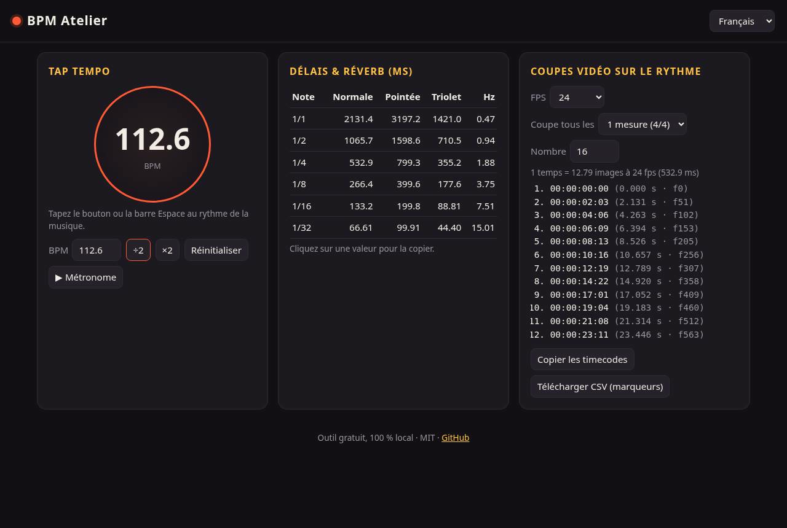
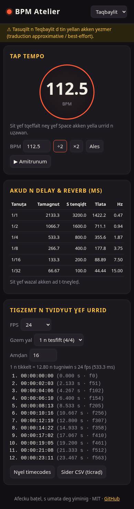

# BPM Atelier

**FR** — Outil gratuit dans le navigateur pour musiciens et monteurs vidéo : tap tempo, temps de délai/réverb synchronisés, et points de coupe vidéo calés sur le rythme (timecodes + export CSV de marqueurs).
**EN** — Free browser tool for musicians and video editors: tap tempo, tempo-synced delay/reverb times, and beat-synced video cut points (timecodes + CSV marker export).

🔗 **Démo / Demo :** https://salimadour31-boop.github.io/bpm-atelier/

## Fonctionnalités / Features
- Tap tempo (clic ou barre Espace), saisie manuelle, ÷2 / ×2, métronome (Web Audio)
- Tableau des délais en ms : notes normales, pointées, triolets + fréquence LFO en Hz (clic = copie)
- Coupes vidéo : FPS 23.976 → 60, coupe tous les 1/2 temps ou 1/2 mesures, timecodes SMPTE, copie et export CSV
- Langues : Français, English, Taqbaylit (kabyle, alphabet latin — *traduction approximative / best-effort*)
- 100 % local, aucune dépendance, aucun build, polices système, responsive

## Utilisation / Usage
Ouvrez `index.html` dans un navigateur, ou utilisez la démo en ligne. / Open `index.html` in any browser, or use the online demo.

## Captures / Screenshots
| Desktop | Mobile (Taqbaylit) |
|---|---|
|  |  |

## Licence
MIT © 2026 Amirouche Amwanes
